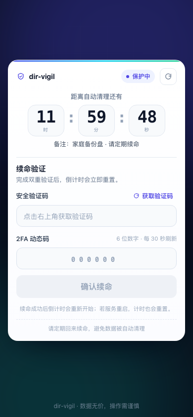
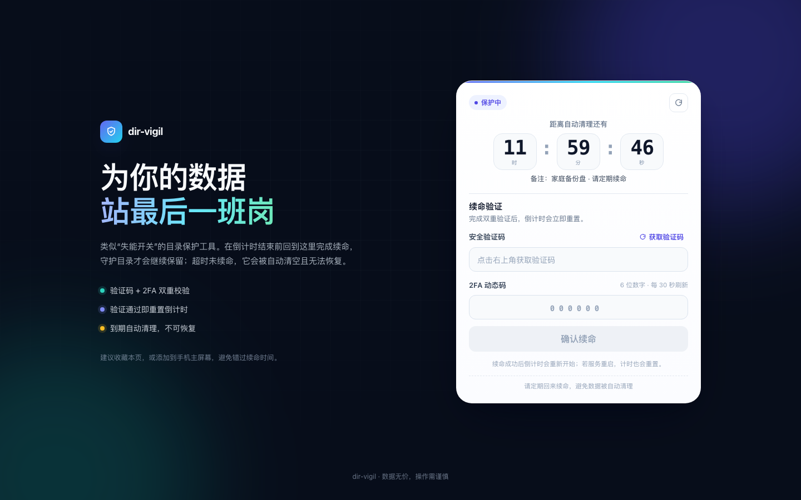

# dir-vigil

English | [中文说明](./README_ZH-CN.md)

dir-vigil is a time-triggered folder cleanup tool built around a "dead man's switch": while you keep checking in, the watched directory is left alone; if the countdown expires without a successful keep-alive, the directory is recursively deleted and the process exits.

> To be blunt: it destroys data after you stop checking in.




> **Data-loss warning:** this software deletes files by design. Use it only on directories you are prepared to lose, and make sure important data is backed up. The authors are not responsible for any data loss.

## 1. How it works

1. Configure a directory to watch and a timeout.
2. Every successful keep-alive (captcha + TOTP 2FA) resets the countdown.
3. If the timeout is reached without a keep-alive, the watched directory is removed recursively and the process exits.
4. Before expiry, reminders can be sent through [Bark](https://github.com/Finb/Bark) or Server Chan (`ServerChan3`).

The web UI is responsive and works on both desktop and mobile. The countdown is calibrated against the server and adapts its warning/critical states automatically.

## 2. Features

- Dead-man's-switch-style timed deletion with a live countdown.
- TOTP 2FA (30-second codes) plus a one-time captcha that is invalidated after a failed 2FA attempt.
- Responsive H5 UI (mobile-first, desktop two-column layout).
- Optional Bark / Server Chan reminders.
- Docker image or bare-metal deployment.
- TOTP secret encrypted at rest with a key supplied via environment variable.

## 3. Quick start (Docker, recommended)

```bash
# build from source (no prebuilt artifacts required)
git clone https://github.com/papudding/dir-vigil.git
cd dir-vigil
docker build -t dir-vigil:0.2.0 .
```

> Prebuilt GHCR images are produced only by the release workflow
> (`.github/workflows/release.yml`) after a `v*` tag is pushed. No image exists
> until that workflow has completed; GHCR may also require `docker login ghcr.io`.

Run it with a dedicated protected directory and a persisted runtime directory:

```bash
# Keep this key safe. Changing it makes an existing user_secret.enc unreadable.
export DIR_VIGIL_SECRET_KEY="$(openssl rand -hex 32)"

docker run -d --name dir-vigil \
  --restart unless-stopped \
  -p 127.0.0.1:8082:80 \
  -v /path/to/protected/dir:/vigilDir \
  -v ~/dir-vigil:/app \
  -e DIR_VIGIL_SECRET_KEY="$DIR_VIGIL_SECRET_KEY" \
  -e TIMEOUT_SECONDS=172800 \
  -e WARNING_SECONDS=43200 \
  -e ALERT_URL='https://your-alert-url' \
  -e ALERT_CHANNEL=bark \
  -e COMMENT='my protected data' \
  dir-vigil:0.2.0
```

- `/vigilDir` is the directory that will be deleted when the timer expires.
- `/app` stores `user_secret.enc`; application logs go to `/app/logs`. Mount a host directory or volume there to keep your 2FA enrollment and logs across container recreation.
- Then print the enrollment QR code from a private terminal:

  ```bash
  docker exec -it dir-vigil dir-vigil --print-secret-uri
  ```

  The QR code/URI contains your 2FA secret. Do not log, screenshot, or share this output.

- Open `http://127.0.0.1:8082` and keep-alive with the captcha + TOTP code.

> The example publishes only to `127.0.0.1`. If you need to access it from a phone on a LAN, put a TLS reverse proxy / access control in front of it and review `nginx/nginx.conf`.

## 4. Bare-metal installation

Prerequisites: Rust stable, Node.js >= 18.12 (Node 22 recommended), Yarn 1.x, and nginx.

```bash
# backend
cd backend
cargo build --release
# binary: backend/target/release/dir-vigil

# frontend
cd ../frontend/h5
yarn install --frozen-lockfile
yarn build
# static files: frontend/h5/dist
```

Copy `frontend/h5/dist` to nginx's `html` directory and adapt `nginx/nginx.conf` (it serves the UI and proxies `/api/` to `127.0.0.1:8080`).

Run the backend from a dedicated runtime directory so `user_secret.enc` and logs are easy to find:

```bash
mkdir -p ~/dir-vigil && cd ~/dir-vigil
export DIR_VIGIL_SECRET_KEY="$(openssl rand -hex 32)"
/absolute/path/to/dir-vigil -d /path/to/protected/dir
```

The backend binds `127.0.0.1` by default. If nginx runs on another host, use `--host` and a trusted proxy.

## 5. Usage

1. Open the UI (or use the API directly).
2. Click **Get captcha**, enter the displayed code and your 6-digit TOTP code, then submit.
   If the 2FA code is wrong, the captcha is consumed immediately; click **Get captcha** again before retrying.
3. A successful keep-alive resets the countdown; the response is a toast and an updated countdown.
4. If no keep-alive arrives before the timeout, the watched directory is deleted and the process exits.

The frontend uses `POST /keepalive` with a JSON body. If you are automating keep-alive, do not put the captcha or TOTP code in URLs.

## 6. Alerts

Set both `ALERT_URL` and `ALERT_CHANNEL` (`bark` or `ServerChan3`) to receive reminders while the remaining time is inside the warning window. The alert URL usually contains a private token and is never written to logs.

## 7. Configuration

### CLI

| Option | Default | Description |
| --- | --- | --- |
| `-d, --directory <DIR>` | required | Directory to track for deletion (required unless `--print-secret-uri`) |
| `-t, --timeout-seconds <SEC>` | `86400` (24h) | Timeout before deletion |
| `-w, --warning-seconds <SEC>` | `21600` (6h) | Start sending reminders when remaining time is below this |
| `-c, --checking-interval <SEC>` | `1200` (20min) | Reminder check interval |
| `--alert-url <URL>` | none | Bark / Server Chan request URL |
| `--alert-channel <CHANNEL>` | none | `bark` or `ServerChan3` (case-sensitive) |
| `--host <ADDR>` | `127.0.0.1` | HTTP listen address |
| `-p, --port <PORT>` | `8080` | HTTP port |
| `--cors-origin <ORIGIN>` | none | Allow one CORS origin (local frontend dev only) |
| `--comment <TEXT>` | none | Comment shown on the status page |
| `--print-secret-uri` | false | Print the TOTP enrollment QR/URI and exit |

The encryption key is **not** a CLI option: it is read from the `DIR_VIGIL_SECRET_KEY` environment variable (64 hex characters or a 32-byte raw string). Generate one with `openssl rand -hex 32`.

### Container environment variables

| Variable | Maps to |
| --- | --- |
| `DIR_VIGIL_SECRET_KEY` | required AES key for `user_secret.enc` |
| `TIMEOUT_SECONDS` | `--timeout-seconds` |
| `WARNING_SECONDS` | `--warning-seconds` |
| `CHECKING_INTERVAL` | `--checking-interval` |
| `ALERT_URL` | `--alert-url` |
| `ALERT_CHANNEL` | `--alert-channel` |
| `COMMENT` | `--comment` |
| `BIND_HOST` | `--host` (optional; defaults to loopback in the container) |

### Upgrading from 0.1.0

- `DIR_VIGIL_SECRET_KEY` is now required. Set it to the legacy key `0123456789abcdef0123456789abcdef` to keep the existing `user_secret.enc`, or delete the file and enroll again.
- `/keepalive` is now `POST` with a JSON body instead of `GET` with query parameters.
- TOTP/alert values are no longer printed into logs. Use `--print-secret-uri` for enrollment.
- The backend now binds `127.0.0.1` by default.
- The Docker image is built from source; release tarballs are no longer published.

## 8. Security notes

- Deletion is irreversible. Test with a temporary directory (`mktemp -d`), never with real data.
- Keep `DIR_VIGIL_SECRET_KEY`, `user_secret.enc`, and alert URLs private. Logs no longer contain the TOTP secret or alert token, but you should still protect runtime directories and backups.
- Keep the captcha single-use and invalidate it after a failed 2FA attempt; rely on TOTP as the real authentication factor. The included nginx config adds rate limiting and security headers.
- For LAN/public access, use a reverse proxy with TLS and access control; the UI includes TOTP but no user account system.
- See [SECURITY.md](./SECURITY.md) for the disclosure policy and limitations.

## 9. Development

```bash
# backend
cd backend
cargo fmt --check
cargo clippy --all-targets -- -D warnings
cargo test

# frontend
cd frontend/h5
cp .env.example .env   # optional; defaults work without it
yarn install --frozen-lockfile
yarn typecheck
yarn build
```

CI runs the same checks (see `.github/workflows/ci.yml`). Contributions are welcome; read [CONTRIBUTING.md](./CONTRIBUTING.md) first. Do not test against real data.

## 10. More

- [SECURITY.md](./SECURITY.md)
- [CONTRIBUTING.md](./CONTRIBUTING.md)
- [CHANGELOG.md](./CHANGELOG.md)

## 11. License

MIT. See [LICENSE](./LICENSE).
