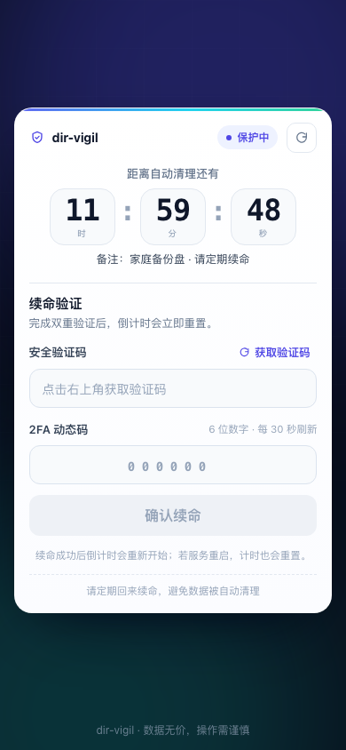
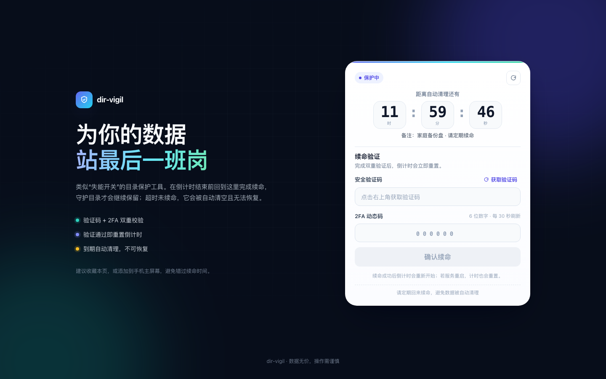

# dir-vigil

[English](./README.md) | 中文说明

dir-vigil 是一款基于时间触发的文件夹自动删除工具，核心机制类似“失能开关”：只要你持续回来续命，受保护目录就不会被清理；如果倒计时结束前没有收到成功的续命请求，目录会被递归删除，进程随后退出。

> 直白一点：你停止签到之后，它帮你销毁数据。




> **数据安全警告：** 本软件的功能就是删除文件，请只在确认可以丢弃的目录上使用，并提前做好重要数据备份。因使用本工具造成的任何数据丢失，作者不承担责任。

## 1. 工作原理

1. 配置要监控的目录和超时时间。
2. 每次成功的续命（验证码 + TOTP 2FA）都会重置倒计时。
3. 超时前没有收到续命请求时，受监控目录会被递归删除，进程退出。
4. 进入提醒窗口后，可以通过 [Bark](https://github.com/Finb/Bark) 或 Server 酱（`ServerChan3`）发送提醒。

前端页面是响应式的，手机和电脑都能使用；倒计时以服务端为准，并自动在“保护中 / 即将到期 / 请立即续命 / 已到期”之间切换状态。

## 2. 功能

- 失能开关式定时删除 + 实时倒计时。
- TOTP 2FA（30 秒验证码）+ 一次性验证码；2FA 输错一次后验证码立即失效。
- 响应式 H5 页面（移动端优先，桌面端双栏）。
- 可选 Bark / Server 酱提醒。
- 支持 Docker 或裸机部署。
- TOTP secret 使用环境变量提供的密钥加密存储。

## 3. 快速开始（Docker，推荐）

```bash
# 使用预构建镜像
docker pull ghcr.io/papudding/dir-vigil:0.2.0

# 或从源码构建（不再依赖仓库里的预编译产物）
git clone https://github.com/papudding/dir-vigil.git
cd dir-vigil
docker build -t dir-vigil:0.2.0 .
```

运行时把受保护目录和运行目录分别挂载进去：

```bash
# 妥善保存这个密钥；更换后旧的 user_secret.enc 将无法解密
export DIR_VIGIL_SECRET_KEY="$(openssl rand -hex 32)"

docker run -d --name dir-vigil \
  --restart unless-stopped \
  -p 127.0.0.1:8082:80 \
  -v /path/to/protected/dir:/vigilDir \
  -v ~/dir-vigil:/app \
  -e DIR_VIGIL_SECRET_KEY="$DIR_VIGIL_SECRET_KEY" \
  -e TIMEOUT_SECONDS=172800 \
  -e WARNING_SECONDS=43200 \
  -e ALERT_URL='https://your-alert-url' \
  -e ALERT_CHANNEL=bark \
  -e COMMENT='我的受保护数据' \
  dir-vigil:0.2.0
```

- `/vigilDir` 是倒计时到期后会被删除的目录。
- `/app` 存放 `user_secret.enc`，应用日志在 `/app/logs/`。请挂载宿主目录或 volume，这样容器重建后 2FA 绑定和日志不会丢。
- 在**私密终端**里打印绑定二维码：

  ```bash
  docker exec -it dir-vigil dir-vigil --print-secret-uri
  ```

  该输出包含 2FA secret，请勿写进日志、截图或分享。

- 打开 `http://127.0.0.1:8082`，输入验证码 + TOTP 完成续命。

> 示例只绑定 `127.0.0.1`。如果手机要访问，请在外层加带 TLS 和访问控制的反向代理，并检查 `nginx/nginx.conf`。

## 4. 裸机安装

依赖：Rust stable、Node.js >= 18.12（推荐 Node 22）、Yarn 1.x、nginx。

```bash
# 后端
cd backend
cargo build --release
# 可执行文件：backend/target/release/dir-vigil

# 前端
cd ../frontend/h5
yarn install --frozen-lockfile
yarn build
# 静态文件：frontend/h5/dist
```

把 `frontend/h5/dist` 复制到 nginx 的 `html` 目录，并按 `nginx/nginx.conf` 配置：静态托管 + `/api/` 反代到 `127.0.0.1:8080`。

建议在专门的运行目录里启动后端，便于找到 `user_secret.enc` 和日志：

```bash
mkdir -p ~/dir-vigil && cd ~/dir-vigil
export DIR_VIGIL_SECRET_KEY="$(openssl rand -hex 32)"
/absolute/path/to/dir-vigil -d /path/to/protected/dir
```

后端默认只监听 `127.0.0.1`。如果 nginx 不在同一台机器，请使用 `--host` 并通过可信代理访问。

## 5. 使用方法

1. 打开页面（或直接调用 API）。
2. 点击“获取验证码”，输入页面验证码和 6 位 TOTP 动态码后提交。
   如果 2FA 动态码输错，验证码会立即失效；重试前需重新点击“获取验证码”。
3. 续命成功会提示并重置倒计时。
4. 超时前没有续命，受监控目录会被删除，进程退出。

前端使用 `POST /keepalive`（JSON body）；如果自行自动化续命，不要把验证码 / TOTP 放进 URL 查询串。

## 6. 提醒配置

同时设置 `ALERT_URL` 和 `ALERT_CHANNEL`（`bark` 或 `ServerChan3`），当剩余时间进入 warning 窗口后会开始发送提醒。提醒 URL 通常包含私有 token，正常日志中不会输出它。

## 7. 配置项

### 命令行

| 参数 | 默认值 | 说明 |
| --- | --- | --- |
| `-d, --directory <DIR>` | 必填 | 要监控并删除的目录（仅 `--print-secret-uri` 时可省略） |
| `-t, --timeout-seconds <SEC>` | `86400`（24 小时） | 删除前倒计时 |
| `-w, --warning-seconds <SEC>` | `21600`（6 小时） | 剩余时间低于该值时开始提醒 |
| `-c, --checking-interval <SEC>` | `1200`（20 分钟） | 提醒检查周期 |
| `--alert-url <URL>` | 无 | Bark / Server 酱请求地址 |
| `--alert-channel <CHANNEL>` | 无 | `bark` 或 `ServerChan3`（大小写敏感） |
| `--host <ADDR>` | `127.0.0.1` | HTTP 监听地址 |
| `-p, --port <PORT>` | `8080` | HTTP 端口 |
| `--cors-origin <ORIGIN>` | 无 | 允许一个 CORS 源（仅本地前端开发用） |
| `--comment <TEXT>` | 无 | 状态页展示的备注 |
| `--print-secret-uri` | false | 打印 TOTP 绑定二维码/URI 后退出 |

加密密钥不是命令行参数，通过环境变量 `DIR_VIGIL_SECRET_KEY` 提供（64 位十六进制或 32 字节原始字符串）。可用 `openssl rand -hex 32` 生成。

### 容器环境变量

| 变量 | 对应参数 |
| --- | --- |
| `DIR_VIGIL_SECRET_KEY` | 必填，`user_secret.enc` 的 AES 密钥 |
| `TIMEOUT_SECONDS` | `--timeout-seconds` |
| `WARNING_SECONDS` | `--warning-seconds` |
| `CHECKING_INTERVAL` | `--checking-interval` |
| `ALERT_URL` | `--alert-url` |
| `ALERT_CHANNEL` | `--alert-channel` |
| `COMMENT` | `--comment` |
| `BIND_HOST` | `--host`（可选，容器内默认回环） |

### 从 0.1.0 升级

- 现在必须设置 `DIR_VIGIL_SECRET_KEY`。沿用已有 `user_secret.enc` 时，请设置为旧版硬编码密钥 `0123456789abcdef0123456789abcdef`；或者删除该文件后重新扫码绑定。
- `/keepalive` 由 `GET` 查询参数改为 `POST` JSON body。
- 正常启动不再把 TOTP secret / 提醒 URL 写进日志；绑定使用 `--print-secret-uri`。
- 后端默认只监听 `127.0.0.1`。
- Docker 镜像从源码多阶段构建，不再发布预编译 tar 产物。

## 8. 安全须知

- 删除不可恢复。测试请只用临时目录（`mktemp -d`），绝对不要指向真实数据。
- 妥善保管 `DIR_VIGIL_SECRET_KEY`、`user_secret.enc` 和提醒 URL。日志已不再包含 TOTP secret / 提醒 token，但运行目录和备份仍需保护。
- 验证码一次性使用，并在 2FA 输错一次后立即失效；真正的鉴权依赖 TOTP。附带 nginx 配置已加入限流和安全头。
- 如果要暴露到局域网/公网，请使用带 TLS 和访问控制的反向代理；本项目只有单用户 TOTP，没有账号体系。
- 漏洞披露方式和安全边界见 [SECURITY.md](./SECURITY.md)。

## 9. 开发

```bash
# 后端
cd backend
cargo fmt --check
cargo clippy --all-targets -- -D warnings
cargo test

# 前端
cd frontend/h5
cp .env.example .env   # 可选；不建 .env 也会使用默认值
yarn install --frozen-lockfile
yarn typecheck
yarn build
```

CI 会执行同样的检查（见 `.github/workflows/ci.yml`）。欢迎提交 PR，先读 [CONTRIBUTING.md](./CONTRIBUTING.md)。测试时不要使用真实数据。

## 10. 更多

- [SECURITY.md](./SECURITY.md)
- [CONTRIBUTING.md](./CONTRIBUTING.md)
- [CHANGELOG.md](./CHANGELOG.md)

## 11. 许可证

MIT，详见 [LICENSE](./LICENSE)。
